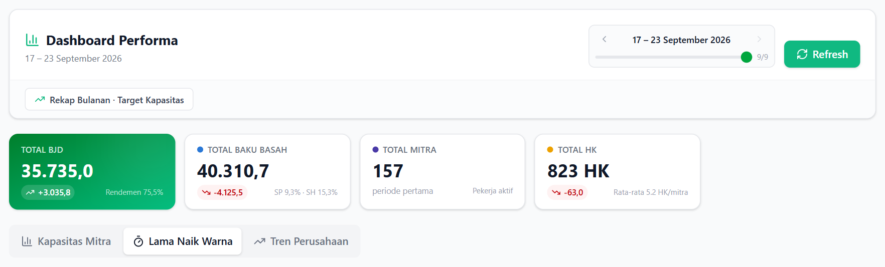
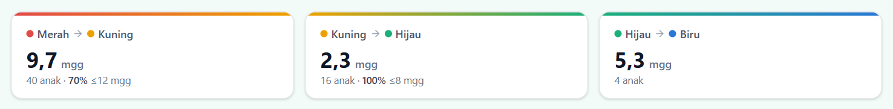
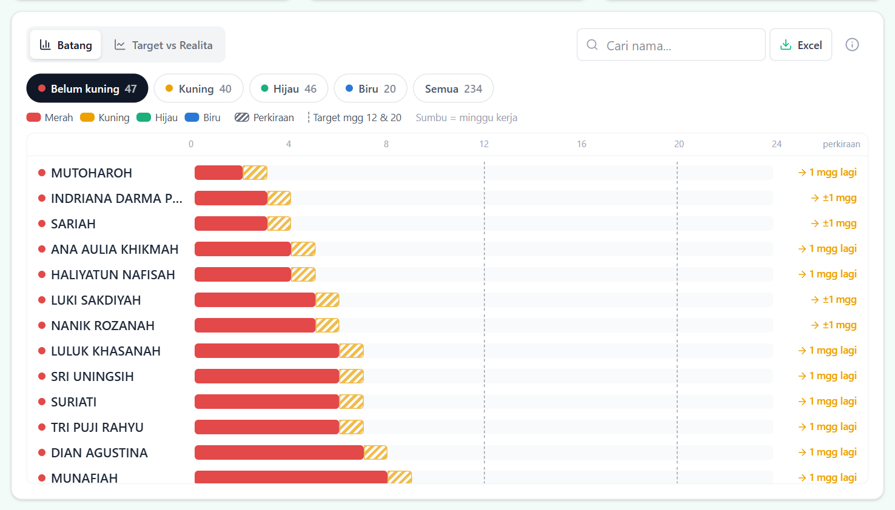
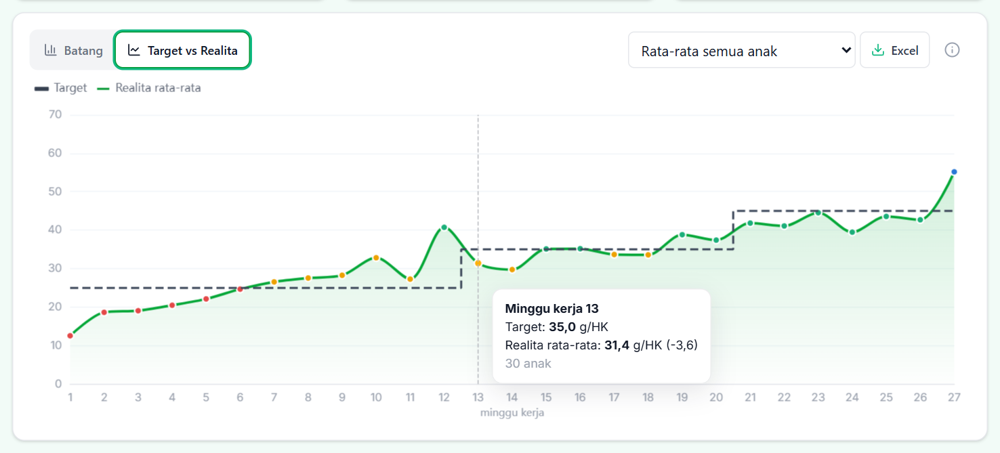
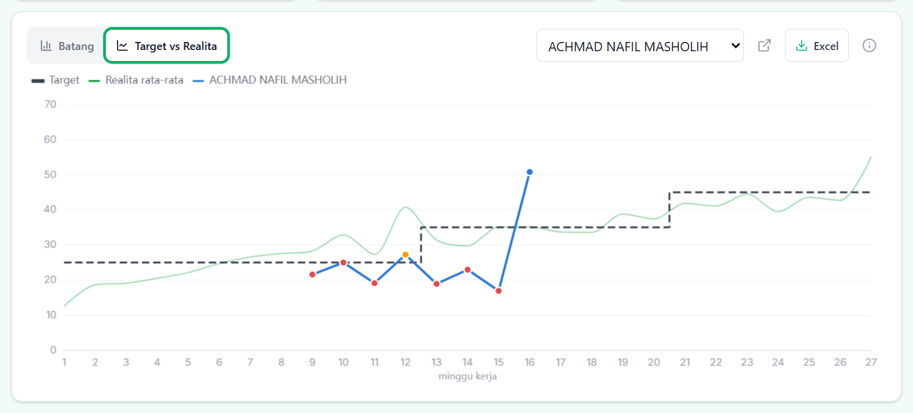
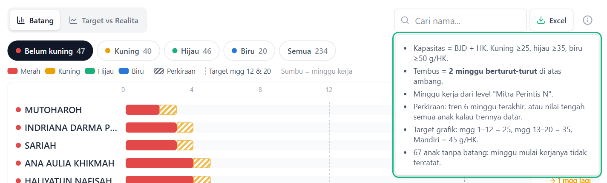
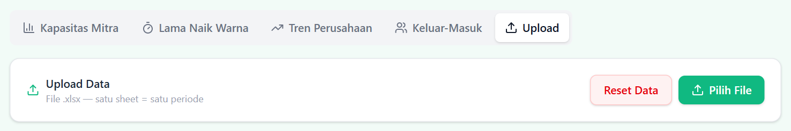
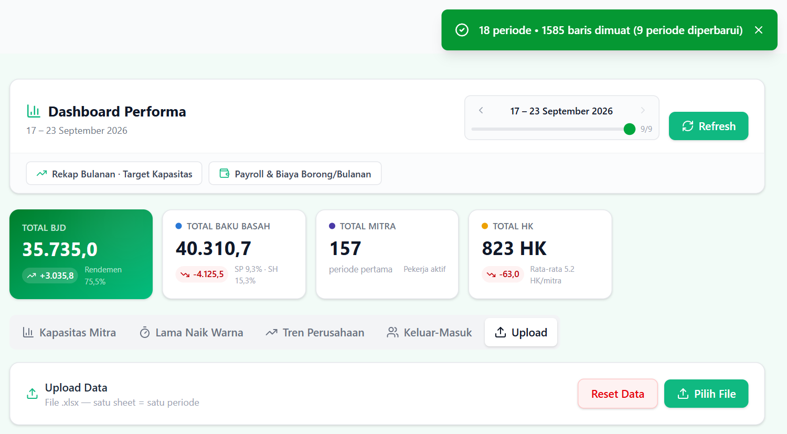

# Dashboard Performa — Lama Naik Warna & Upload Excel

Panduan untuk manager: membaca grafik **Lama Naik Warna** (berapa minggu anak
naik dari merah → kuning → hijau → biru), mengunduh tabelnya ke Excel, dan
meng-upload file Excel mingguan.

> Halaman: **`/performa`** · tab **Lama Naik Warna**
> (tautan langsung: `/performa?tab=naik-warna`)

---

## 1. Tab di Dashboard Performa

Dashboard dibagi per tab supaya tidak perlu scroll panjang. Ringkasan periode
(Total BJD, Baku Basah, Mitra, HK) tetap di atas, isi di bawahnya berganti
sesuai tab.

| Tab | Isi | Siapa |
|---|---|---|
| Kapasitas Mitra | Ranking & detail per anak | Semua |
| **Lama Naik Warna** | Lama naik warna, prediksi, target vs realita | Semua |
| Tren Perusahaan | Grafik antar periode | Semua |
| Keluar-Masuk | Anak masuk/keluar & pindah shift | Manager (login) |
| Upload | Upload / reset data Excel | Manager (login) |

---

## 2. Warna kapasitas

Kapasitas = **BJD ÷ HK** (gram barang jadi per hari kerja).

| Warna | Kapasitas |
|---|---|
| 🔴 Merah | di bawah 25 g/HK |
| 🟡 Kuning | 25 – 35 g/HK |
| 🟢 Hijau | 35 – 50 g/HK |
| 🔵 Biru | 50 g/HK ke atas |

Anak dihitung **tembus** ke warna berikutnya kalau **2 minggu berturut-turut**
di atas ambangnya. Satu minggu bagus saja belum dihitung, karena kapasitas
mingguan sering naik-turun tajam.

---

## 3. Kartu ringkasan

Setiap kartu = rata-rata **berapa minggu** yang dibutuhkan semua anak untuk
satu perpindahan warna.

- **Merah → Kuning** — minggu kerja ke berapa anak tembus kuning.
  `70% ≤12 mgg` = 70% anak sudah tembus sebelum target minggu ke-12.
- **Kuning → Hijau** — berapa minggu setelah kuning sampai tembus hijau.
  Target: ≤ 8 minggu (hijau paling lambat minggu ke-20).
- **Hijau → Biru** — berapa minggu dari hijau sampai biru (belum ada target).
- `40 anak` = jumlah anak yang perpindahannya tercatat di data.

---

## 4. Tampilan **Batang** — perjalanan warna per anak

### Legenda

| Simbol | Arti |
|---|---|
| Kotak warna | Fase warna anak (merah, kuning, hijau, biru) |
| Kotak **berarsir** | **Perkiraan** sampai anak tembus warna berikutnya |
| Garis putus-putus | Target minggu ke-12 (kuning) dan ke-20 (hijau) |
| Sumbu angka (0, 4, 8, …) | **Minggu kerja** anak |

### Cara membaca satu baris

- Batang dimulai dari minggu kerja 0 sampai minggu kerja sekarang.
- Warna batang berganti di minggu anak itu tembus warna berikutnya.
- Kolom kanan **perkiraan**:
  - `→ ±3 mgg` — diperkirakan tembus warna berikutnya ±3 minggu lagi.
  - `→ 1 mgg lagi` — minggu ini sudah di atas ambang, tinggal 1 minggu lagi
    supaya dihitung tembus.
  - `→ tren datar` — kapasitasnya tidak naik, jadi belum bisa diperkirakan.
    **Anak ini yang perlu diperhatikan.**

### Filter & cari

- Tombol **Belum kuning / Kuning / Hijau / Biru / Semua** — angka di tombol =
  jumlah anak aktif di kelompok itu. Daftar diurutkan dari yang paling cepat
  diperkirakan naik.
- Kotak **Cari nama** untuk mencari satu anak.
- **Klik nama anak** → langsung pindah ke grafik Target vs Realita anak itu.

---

## 5. Tampilan **Target vs Realita** — grafik naik-turun

Klik tombol **Target vs Realita** di kiri atas panel.

- **Garis putus-putus hitam = target** per minggu kerja (sama dengan tangga
  target di Rekap Bulanan):
  - Minggu 1–12: **25 g/HK**
  - Minggu 13–20: **35 g/HK**
  - Mandiri (> 20 minggu): **45 g/HK**
- **Garis hijau = realita**, rata-rata kapasitas semua anak di minggu kerja
  yang sama. Warna titik = warna kapasitasnya.
- Arahkan kursor ke grafik untuk melihat angka: target, realita, **selisih**,
  dan jumlah anak di minggu itu.
- Garis hijau **di atas** garis target = sesuai target, **di bawah** = belum.

### Per anak

Pilih nama di dropdown kanan atas (atau klik nama di tampilan Batang).

- **Garis biru** = anak yang dipilih; rata-rata semua anak jadi garis hijau pudar
  sebagai pembanding.
- Ikon **↗** di sebelah dropdown membuka detail anak di tab Kapasitas Mitra.

---

## 6. Cara hitung (ikon ⓘ)

- **Minggu kerja** dibaca dari level "Mitra Perintis N" di Excel. Anak yang
  sudah "Mandiri" sejak data pertama tidak diketahui minggu mulainya: mereka
  tetap ada di daftar, tapi tanpa batang.
- Anak yang sudah kuning/hijau sejak data pertama **tidak ikut rata-rata**,
  karena kapan ia tembus tidak tercatat.
- **Perkiraan** memakai tren kenaikan 6 minggu terakhir anak itu. Kalau
  trennya datar/turun, dipakai nilai tengah semua anak. Kalau anak sudah
  melewati nilai tengah itu tanpa naik, ditulis "tren datar" (tidak diberi
  angka palsu).

---

## 7. Download ke Excel

Klik tombol **⬇ Excel** di kanan atas panel. File
`Lama Naik Warna - <periode terbaru>.xlsx` berisi 4 sheet:

| Sheet | Isi |
|---|---|
| **Ringkasan** | Rata-rata, nilai tengah, jumlah anak, % dalam target untuk tiap perpindahan warna; jumlah anak per warna; cara hitung |
| **Per Anak** | Status warna, minggu kerja, kapasitas terakhir, minggu tembus kuning/hijau/biru, lama tiap perpindahan, **prediksi** (menuju warna apa, berapa minggu lagi, tembus di minggu ke-berapa, dasar prediksi). Sudah ada filter. |
| **Target vs Realita** | Per minggu kerja: target, realita, selisih, jumlah anak, "Sesuai / Di bawah target" |
| **Data Mingguan** | Data mentah g/HK per anak per periode (bahan hitungan) |

Angka di file sama persis dengan yang tampil di layar.

---

## 8. Cara upload Excel

Hanya untuk akun manager yang sudah login.

1. Buka tab **Upload**.

   

2. Klik **Pilih File**, pilih file `.xlsx` mingguan.
3. Tunggu sampai muncul notifikasi hijau. Untuk file ±13 MB biasanya
   **±5 detik**.

   

   `18 periode • 1585 baris dimuat (9 periode diperbarui)` artinya 18 sheet
   terbaca menjadi 9 periode; periode yang sudah pernah di-upload **diganti**,
   bukan ditambah dobel.

### Syarat file

- Format **.xlsx** (bukan .xls lama — buka di Excel lalu *Save As → Excel Workbook*).
- Ukuran maksimal **50 MB**.
- Satu periode = sheet **DATA PERIODE …** + **REKAP PAYROLL …** dengan nama
  periode yang sama (mis. `DATA PERIODE 17 - 23 SEPT` dan
  `REKAP PAYROLL 17 - 23 SEPT`).
- Sheet yang **di-hide tidak dibaca**. Unhide dulu kalau periodenya mau masuk.
- Formula harus sudah terhitung. Kalau muncul peringatan kuning "formula Excel
  belum ter-recalculate", buka file di Excel, tekan **Ctrl+Alt+F9**, simpan,
  lalu upload ulang.

### Tips supaya file tetap kecil

Kalau format/border sheet ditarik sampai baris paling bawah Excel
(baris 1.048.576), ukuran file membengkak walaupun datanya cuma ratusan baris.
Sistem sudah membuang baris kosong ini otomatis, tapi file tetap lebih kecil
dan cepat di-upload kalau dibersihkan:

1. Klik nomor baris pertama **di bawah** data terakhir.
2. Tekan **Ctrl+Shift+↓** untuk memilih sampai baris paling bawah.
3. Klik kanan → **Delete** (hapus baris), lalu simpan.

### Reset Data

Tombol **Reset Data** menghapus **semua** data performa (semua periode).
Tidak bisa dibatalkan — gunakan hanya kalau mau mulai dari nol.

---

## 9. Pertanyaan umum

**Kenapa ada anak di "Belum kuning" padahal minggu ini kapasitasnya di atas 25?**
Baru satu minggu. Tunggu satu minggu lagi di atas 25 supaya dihitung tembus
(perkiraannya tertulis `→ 1 mgg lagi`).

**Kenapa ada anak tanpa batang?**
Minggu mulai kerjanya tidak tercatat (sudah "Mandiri" sejak data pertama).

**Kenapa jumlah anak di kartu lebih kecil dari jumlah mitra?**
Kartu hanya menghitung anak yang perpindahan warnanya **benar-benar terlihat**
di data — yang sudah kuning sejak data pertama tidak ikut.

**Angka di Excel beda dengan layar?**
Tidak bisa — keduanya dihitung dari data yang sama. Pastikan periode yang
di-upload sudah yang terbaru (tombol **Refresh**).
